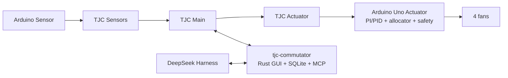

# План работ: управление охлаждением теплоизоляционного блока

## Цель прототипа

Построить двухконтурную систему охлаждения теплоизоляционного блока 3D-принтера:

- Arduino Uno на узле актуаторов автономно регулирует температуру, управляет четырьмя вентиляторами, обнаруживает их отказ и выполняет safety-политику;
- Rust-приложение принимает и хранит телеметрию, предоставляет операторский интерфейс и защищённый MCP-сервер;
- DeepSeek Harness выполняет медленный агентный анализ и через ограниченные MCP tools предлагает обратимые изменения настроек;
- TJC-платы остаются простым транспортом с автоматами фиксированной длины.

Недоступность компьютера, Harness или модели не должна останавливать локальное управление.

## Зафиксированные параметры прототипа

| Параметр | Значение |
| --- | --- |
| Целевая плата актуаторов | Arduino Uno |
| Вентиляторы | 4, с индивидуальными идентификаторами и весами |
| Диапазон цели оператора | 0–60 °C |
| Допуск регулирования | target ±2 °C |
| Полное разрешённое охлаждение | при target +5 °C |
| Максимальное воздействие | PWM 255 |
| Аварийное превышение | target +15 °C |
| Локальный такт | 1 с |
| Обновление температуры через TJC | 2 с; PID обновляется только по свежему измерению |
| Потеря свежей температуры | через 5 с включается аварийное охлаждение |
| Стартовый регулятор | PI, `kd = 0`; код поддерживает полный PID |
| Первичное обнаружение отказа | локально на Arduino |
| Стартовое правило отказа | PWM ≥80, 3 с на запуск, затем 3 последовательных секундных измерения с RPM=0 |
| Кандидатная конфигурация | 10 минут; без подтверждения выполняется откат |
| Изменение PID агентом | один коэффициент за окно, не более 10% |
| Плановый агентный цикл | 5 минут в NORMAL, 2 минуты при кандидате, открытой двери, деградации или аварии |
| Длительность запуска прототипа | до 1 суток; данные запуска не очищаются автоматически |

Максимальные RPM и охлаждающая способность конкретных вентиляторов будут откалиброваны позднее. До калибровки агент вправе экспериментировать с весами через кандидатную конфигурацию и автоматический откат.

## Границы безопасности

- Arduino немедленно включает PWM 255 на доступных вентиляторах при аварийном превышении или потере свежей внутренней температуры.
- `clear_emergency` сразу снимает режим, но safety-условие проверяется каждый такт и может тут же включить его снова.
- Подтверждённо отказавший вентилятор обесточивается и исключается из распределения.
- Агент или оператор может вызвать `probe_fan`; только Arduino возвращает вентилятор в работу после успешной проверки RPM. Между попытками действует cooldown, а при перегреве проверка запрещена.
- Агент не меняет target, прямой PWM, диапазон цели и аварийные пределы.
- Политика открытой двери выбирается агентом только из `FANS_OFF`, `LIMITED`, `CONTINUE`; по умолчанию действует `FANS_OFF`, а авария имеет приоритет.
- Rust и Arduino независимо проверяют диапазоны, версии и допустимость каждой изменяющей команды.

## Этап 0. Спецификация протокола

Репозиторий: `tjc-sketch`.

1. Создать `docs/protocol.md` как единственный источник кодов команд, порядка полей, масштаба чисел и тайм-аутов.
2. Зафиксировать для каждого сообщения неизменный позиционный формат. Динамическую длину, экранирование и CRC не вводить.
3. Использовать `OK` только после всех ожидаемых полей. Любое значение внутри полей, включая `3`, считать данными.
4. Передавать RPM непосредственно как big-endian `uint16`, без нормализации и замены байтов.
5. Описать новые команды чтения конфигурации, применения кандидата, подтверждения, отката, политики двери, `probe_fan` и `clear_emergency`.
6. Подготовить общие тестовые векторы: отрицательная температура, RPM с байтом `3`, границы 0/4000/6000/65535, неполное сообщение и тайм-аут.

Выход этапа: спецификация позволяет независимо реализовать один и тот же обмен в Arduino, GraphML и Rust.

## Этап 1. Переносимое ядро и симулятор

Репозиторий: `arduino-actuator`.

1. Добавить PlatformIO-окружения `native` и `uno`.
2. Вынести из `.ino` независимое от Arduino API C++-ядро:
   - PI/PID с ограничением выхода, anti-windup и фильтром производной;
   - распределитель четырёх PWM по весам доступных вентиляторов;
   - монитор команды/RPM и защёлкивание отказа;
   - режимы NORMAL, DOOR_OPEN, DEGRADED, EMERGENCY;
   - контроль свежести температуры;
   - стабильную и кандидатную конфигурации с версиями;
   - детерминированные safety-переходы.
3. Оставить `.ino` тонким адаптером времени, EEPROM, AustereSerialMaster, PWM, реле и тахометров.
4. Хранить подтверждённую конфигурацию и её версию в EEPROM; кандидата держать в RAM. После перезапуска всегда загружать стабильную версию.
5. Реализовать симулятор первого порядка: нагрев принтера, теплообмен со средой, дверь, четыре виртуальных вентилятора, воспроизводимый шум и инъекция отказов.
6. Добавить нативные unit- и scenario-тесты. В каждом изменении запускать native-тесты и сборку `uno`.

Выход этапа: один и тот же управляющий код проходит симуляцию и собирается для Arduino Uno.

## Этап 2. Валидность датчиков

Репозиторий: `arduino-sensor`.

1. Изменить интерфейс DS18B20 так, чтобы он различал новое корректное измерение, повтор последнего значения, отсутствие датчика и ошибку CRC.
2. Передавать две температуры и один битовый байт `valid/fresh`.
3. Сохранить неблокирующее преобразование DS18B20.
4. Добавить тесты кодирования температур, включая отрицательные значения и первый запуск датчика.

Выход этапа: актуатор отличает свежую температуру от регулярно пересылаемого устаревшего значения.

## Этап 3. Обновление автоматов TJC

Репозиторий: `tjc-sketch`.

1. Обновить `Скетч.graphml` по `docs/protocol.md`.
2. Убрать из центральной TJC-платы самостоятельное пороговое управление температурой: она передаёт измерение, цель, состояние двери и команды конфигурации актуатору.
3. Принимать RPM строго как восемь позиционных байтов и только затем ожидать `OK`.
4. Передавать статус свежести датчиков, `doorOpen` и стадию двери. Сырые значения трёх концевиков на компьютер не отправлять.
5. Ретранслировать конфигурационные команды и ответы без вычисления PID и весов на TJC.
6. Обновить телеметрию фиксированного формата и тайм-ауты восстановления автомата.
7. Проверить валидность XML и вручную открыть модель в совместимом редакторе перед прошивкой TJC.

Выход этапа: TJC надёжно транспортирует все необходимые фиксированные сообщения, не интерпретируя байты полезной нагрузки как разделители.

## Этап 4. Прошивка актуатора и сквозной протокол

Репозитории: `arduino-actuator`, `arduino-sensor`, `tjc-sketch`.

1. Подключить переносимое ядро к реальным датам, PWM, реле и RPM.
2. Реализовать команды протокола и ответы с версиями/статусами.
3. Передавать наверх:
   - внутреннюю и наружную температуры с `valid/fresh`;
   - датчик Холла;
   - `doorOpen` и стадию двери;
   - target, режим и активную политику двери;
   - версии стабильной и кандидатной конфигураций;
   - четыре фактических PWM и четыре RPM;
   - битовую маску подтверждённых отказов.
4. Не передавать сырые концевики и внутренний выход PID.
5. Удалить замену байта RPM `3 → 255`.
6. Синхронизировать README с фактической распиновкой, PWM 255 и новым протоколом.

Выход этапа: стенд автономно регулируется и выдаёт полный согласованный снимок без участия агента.

## Этап 5. Rust-приложение, SQLite и MCP

Репозиторий: `tjc-commutator`.

1. Разделить текущий монолитный `main.rs` на модули serial/protocol, state, telemetry, config, MCP и UI.
2. Сделать Rust-версию единственным продуктовым приложением; Python оставить только как явно обозначенные диагностические утилиты.
3. Переписать декодер под `docs/protocol.md` и общие тестовые векторы.
4. Добавить SQLite с идентификатором запуска и таблицами измерений, событий, конфигураций, tool calls и решений. Для однодневного прототипа хранить всё без фоновой очистки.
5. После подключения читать фактическую стабильную/кандидатную конфигурацию с Arduino, а не считать локальную копию источником истины.
6. Расширить GUI: режим, свежесть датчика, четыре PWM/RPM, отказ, кандидатная версия, агентные решения, предупреждения и ручные `probe_fan`/`clear_emergency`.
7. Поднять Streamable HTTP MCP только на `127.0.0.1`, защитить случайным токеном и журналировать каждый вызов.

Читающие tools:

- `get_system_state` — один согласованный снимок; наружу выходят `doorOpen` и стадия, но не сырые концевики;
- `get_temperature_history` — агрегированная история;
- `get_control_config` — стабильная и кандидатная конфигурации;
- `get_pending_events` — очередь необработанных событий.

Изменяющие tools:

- `propose_pid_change`;
- `propose_fan_weights`;
- `set_door_policy`;
- `confirm_config`;
- `rollback_config`;
- `probe_fan`;
- `clear_emergency`;
- `create_operator_alert`.

Выход этапа: GUI, база и MCP отражают фактическое состояние Arduino и не могут обойти локальную safety-политику.

## Этап 6. DeepSeek Harness

Репозиторий: отдельный `tjc-deepseek-harness`.

1. Подготовить конфигурацию с точной закреплённой версией Harness и отдельный скрипт запуска. Не размещать зависимости и конфигурацию Harness в `tjc-commutator`.
2. Не устанавливать и не запускать Harness на текущей машине; проверку выполнить на другой целевой машине.
3. Подключить MCP-клиент к loopback URL и передать токен через переменную окружения.
4. Создать отдельный профиль управления без shell, файловых, web- и прочих инструментов общего назначения.
5. Добавить системный prompt с запретом изменения target и safety-пределов, предпочтением одного малого изменения и обязательным объяснением решения.
6. Реализовать адаптивное расписание: 5 минут в NORMAL, 2 минуты при кандидате, открытой двери, DEGRADED или EMERGENCY.
7. Ограничить число шагов/tool calls одного запуска, тайм-аут и стоимость.

Включение полномочий:

1. read-only;
2. dry run всех изменяющих tools;
3. автоматические кандидатные веса;
4. автоматическая кандидатная настройка PID;
5. подтверждение и откат только после проверки метрик окна.

Выход этапа: Harness анализирует реальную телеметрию через узкий MCP-профиль, а его отсутствие не влияет на Arduino.

## Этап 7. Проверка и приёмка

### Симуляционные сценарии

1. Выход на target и удержание в диапазоне ±2 °C не менее 90% оставшегося 30-минутного сценария после первого входа в диапазон.
2. Нормальная работа при полностью отключённых Rust-приложении и Harness.
3. Отказ одного вентилятора: обнаружение по стартовому правилу, отключение и перераспределение.
4. Краткий провал RPM не фиксируется как отказ.
5. Несколько отказов и недостаточная оставшаяся мощность.
6. `probe_fan`: неудачная и успешная проверка, cooldown, запрет при перегреве.
7. Потеря свежей температуры более чем на 5 с.
8. Открытая дверь для каждой разрешённой политики; авария перекрывает политику двери.
9. Достижение target +15 °C, `clear_emergency` и немедленное повторное срабатывание при сохраняющемся условии.
10. Невалидная цель вне 0–60 °C.
11. Устаревшая версия, повторный decision ID и некорректные числа.
12. Ухудшение после кандидата, тайм-аут подтверждения и перезапуск Arduino — во всех случаях возврат к стабильной конфигурации.
13. RPM, один из байтов которого равен `3`, проходит без искажения.
14. Недоступность Harness, API или MCP-клиента.

### Сквозная приёмка

- Все четыре репозитория используют согласованный фиксированный протокол.
- Arduino Uno укладывается в доступную RAM/flash и продолжает регулирование без ПК.
- Rust хранит полный однодневный запуск и восстанавливает причину каждого изменения.
- Агент не может изменить target, прямой PWM, safety-порог или вернуть вентилятор без успешной локальной проверки.
- Любая кандидатная конфигурация подтверждается либо автоматически откатывается.
- README и фактическая распиновка не противоречат друг другу.

## Порядок выполнения

Работы выполняются последовательно по главным зависимостям:

1. спецификация протокола и тестовые векторы;
2. переносимое C++-ядро и native-симулятор;
3. валидность датчиков;
4. автоматы TJC;
5. сквозная Arduino-телеметрия;
6. Rust/SQLite/MCP;
7. профиль Harness;
8. dry run, автоматические веса, затем PID;
9. однодневный прогон прототипа.

Параллельно после фиксации `docs/protocol.md` можно развивать C++-ядро и Rust-декодер, но изменения GraphML должны опираться на уже согласованные форматы сообщений.

## Отложено после прототипа

- калибровка зависимости `PWM → RPM → охлаждающая способность` каждого вентилятора;
- окончательный абсолютный температурный предел реального оборудования;
- долговременная политика хранения телеметрии;
- автоматический запуск и обновление DeepSeek Harness из GUI;
- доказательство пользы ненулевого `kd` на реальном стенде;
- более сложный протокол с CRC или подтверждением целостности, если реальные испытания покажут необходимость.
